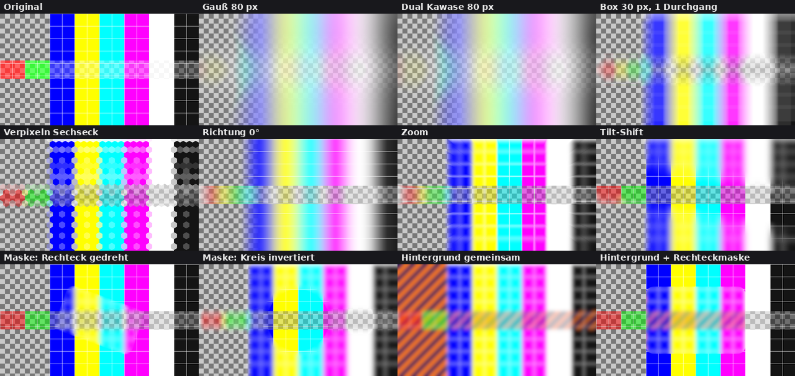

# Areadox Blur

Ein Weichzeichner-Filter für **OBS Studio 33+** im Stil von
[Composite Blur](https://github.com/FiniteSingularity/obs-composite-blur) –
komplett in **Rust** geschrieben, ohne C-Code und ohne OBS-SDK zum Bauen.



## Funktionen

| Bereich | Optionen |
|---|---|
| **Algorithmen** | Gauß, Box (1–5 Durchgänge), Dual Kawase, Verpixeln (Quadrat / Sechseck) |
| **Typen** | Fläche, Richtung (Bewegung), Zoom (mit scharfem Zentrum), Tilt-Shift (drehbar) |
| **Masken** | Zuschneiden, Rechteck (gedreht, abgerundete Ecken), Kreis, andere Quelle, Bilddatei – jeweils mit weicher Kante und Umkehren; Quelle/Bild per Alpha, Helligkeit oder R/G/B |
| **Hintergrund** | Beliebige Quelle oder Szene hinter die Quelle legen: *gemeinsam weichzeichnen* (wie Composite Blur) oder *Milchglas* (nur der Hintergrund wird weich, die Quelle bleibt scharf) |

Einheitlicher **Radius**: Bei allen Algorithmen entspricht ein Radius von *r* Pixeln
einer Standardabweichung von *r*/2 – Gauß, Box und Dual Kawase sind bei gleichem
Radius gleich stark (gemessen an einer Kante in libobs, Abweichung < 5 %).
Große Radien (bis 500 px) werden automatisch auf verkleinerten Zwischenbildern
berechnet, damit die Leistung konstant bleibt.

### OBS-33-Standard

* **Neues Plugin-Layout** von OBS 33 (keine „Legacy“-Markierung im Plugin-Manager)
* `data/manifest.json` mit Name, Version, Beschreibung und Links für den Plugin-Manager
* libobs-API 33.0 (`obs_source_info` inkl. aller OBS-33-Felder, Layout zur Compile-Zeit geprüft)
* Farbraum-bewusst (`OBS_SOURCE_SRGB`, `video_get_color_space`, SDR und HDR/16-Bit-Float);
  intern wird mit vormultipliziertem Alpha in linearem Licht gerechnet – keine dunklen Ränder
* Quellen werden per **UUID** referenziert (Umbenennen bricht nichts)
* Oberfläche auf **Deutsch und Englisch**

## Installation

Die fertigen Pakete baut die GitHub-CI (Reiter *Actions* bzw. *Releases*).

**Windows:** `areadox-blur-<version>-windows-x64-installer.exe` ausführen (Admin-Rechte nötig) –
der Installer legt das Plugin im OBS-33-Pfad ab und lässt sich über *Apps & Features*
wieder entfernen. Alternativ das ZIP manuell entpacken:

| System | Zielordner |
|---|---|
| Windows | `C:\ProgramData\obs-studio\plugins\areadox-blur\` (enthält `areadox-blur.dll` und `data\`) |
| Linux | `~/.local/share/obs-studio/plugins/areadox-blur/` (enthält `areadox-blur.so` und `data/`) |
| macOS | `~/Library/Application Support/obs-studio/plugins/areadox-blur.plugin` |

Danach OBS neu starten → Rechtsklick auf eine Quelle → *Filter* → ➕ → **Areadox Blur**.

## Selbst bauen

Voraussetzung: Rust (stable, ≥ 1.80). Ein OBS-SDK wird **nicht** benötigt – unter
Windows erzeugt `rustc` die Importe für `obs.dll` selbst (`raw-dylib`), unter
Linux/macOS löst OBS die Symbole beim Laden auf.

```powershell
# Windows (PowerShell)
.\scripts\package.ps1            # -> dist\areadox-blur-<version>-windows-x64.zip
.\scripts\package.ps1 -Install   # zusätzlich installieren (Admin-PowerShell)
iscc /DAppVersion=0.1.0 installer\areadox-blur.iss   # Installer (Inno Setup 6)
```

```bash
# Linux / macOS
scripts/package.sh               # -> dist/...
scripts/package.sh --install     # zusätzlich für den aktuellen Benutzer installieren
```

## Tipps zur Nutzung

* **Milchglas-Effekt:** Filter auf ein halbtransparentes Overlay legen, als Hintergrund
  die Spielquelle wählen, Modus *Milchglas*. Quelle und Hintergrund sollten beide die
  Leinwandgröße haben, damit sie deckungsgleich sind.
* **Bereich weichzeichnen:** Hintergrund *gemeinsam* + Maske *Rechteck* ergibt ein
  verschwommenes Panel mit abgerundeten Ecken.
* Wird die eigene Szene als Hintergrund gewählt, erscheint die gefilterte Quelle darin
  ungefiltert (Schutz vor Endlos-Rekursion).

## Projektaufbau

```
src/lib.rs        Modul-Einstieg (obs_module_load, Locale, Metadaten)
src/ffi.rs        handgeschriebene libobs-33-Bindings
src/filter.rs     Filter-Lebenszyklus, Einstellungen, Quellen-Referenzen
src/props.rs      Eigenschaften-Dialog
src/render.rs     GPU-Pipeline (Erfassen → Hintergrund → Blur → Tilt/Maske → Ausgabe)
core/             OBS-unabhängige Logik mit Unit-Tests (Planung, Geometrie, Kalibrierung)
data/effects/     Shader im OBS-Effect-Format (OBS übersetzt sie für Direct3D 11 und OpenGL)
data/locale/      de-DE / en-US
installer/        Inno-Setup-Skript für den Windows-Installer
tests/harness/    Integrationstest gegen ein echtes, headless gebautes libobs
```

### Tests

```bash
cargo test --workspace                        # Unit-Tests
OBS_SRC=/pfad/zu/obs-studio tests/harness/run.sh   # rendert alle Modi in libobs
```

Der Integrationstest lädt das Plugin in libobs (OpenGL über Xvfb), rendert jeden
Algorithmus, Typ, jede Maske und beide Hintergrund-Modi, prüft den
Rekursionsschutz und die Freigabe von Quellen-Referenzen.

## Lizenz

GPL-2.0-or-later (wie OBS Studio, gegen dessen libobs das Plugin gelinkt wird).
Composite Blur von FiniteSingularity diente als funktionales Vorbild; Code und
Shader sind eigenständig neu geschrieben.
